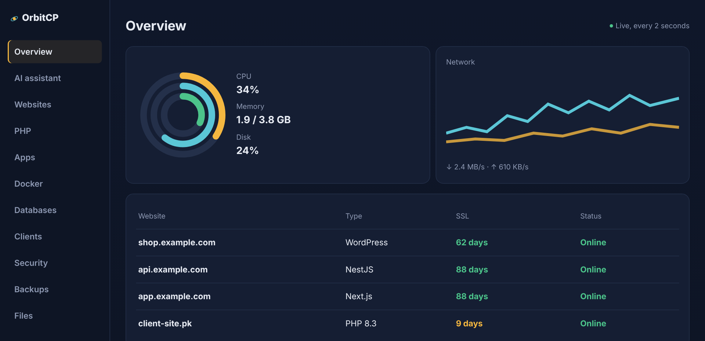

<p align="center">
  <a href="https://orbitcp.pro">
    <picture>
      <source media="(prefers-color-scheme: dark)" srcset="assets/images/logo-dark-mode.png">
      
    </picture>
  </a>
</p>

<p align="center">
  <a href="https://orbitcp.pro">Website</a> ·
  <a href="https://orbitcp.pro/docs/">Docs</a> ·
  <a href="https://orbitcp.pro/changelog/">Changelog</a> ·
  <a href="https://github.com/orbitcp/orbitcp/issues">Issues</a> ·
  <a href="https://github.com/orbitcp/orbitcp/discussions">Discussions</a> ·
  <a href="https://discord.gg/YAF7We7sg">Discord</a>
</p>

<p align="center">
  <a href="https://discord.gg/YAF7We7sg"></a>
  <a href="https://github.com/orbitcp/orbitcp/releases/latest"></a>
</p>

[OrbitCP](https://orbitcp.pro) is a modern server control panel with an AI assistant built in. Run websites,
WordPress, Node.js and Python apps, Docker, databases and backups from one clean screen, and host your own
customers on your VPS.

The AI assistant reads your logs, finds the cause of a problem and proposes a fix. Nothing changes on your server
until you press **Approve**.

<p align="center">
  
</p>

## ✨ Highlights

- **Free plan**, no license key needed
- **AI assistant** that investigates by itself and fixes things only after you approve them
- **Websites and free SSL**: static, PHP and reverse proxy, with certificates that renew themselves
- **One-click WordPress**, plus **Node.js and Python apps from Git** (Next.js, NestJS, Express, Flask, Django, FastAPI)
- **Docker** with an App Store and your own compose stacks
- **Databases**: MariaDB with phpMyAdmin, PostgreSQL 17 with PostGIS, Redis
- **Client accounts** to host your customers, each in their own isolated Linux user, with packages and limits
- **Security Center**: firewall, brute-force protection, safe SSH settings, web firewall and malware scans
- **Backups and cron jobs**, file manager and web terminal
- Ready in about **3 minutes**, one command to install and upgrade
- **Ubuntu 22.04, 24.04 and Debian 12**

## 💾 Installation

On a fresh server, as root:

```bash
curl -fsSL https://orbitcp.pro/install.sh | sudo bash
```

The installer prints your private panel link and admin password at the end. Run the same command again to upgrade.

Step-by-step guide: **[orbitcp.pro/docs](https://orbitcp.pro/docs/)**

Works on any VPS or dedicated server: Linode (Akamai), DigitalOcean, Vultr, Hetzner, AWS Lightsail and others.
At least 1 GB of memory; 2 GB or more for Node.js apps and Docker.

## 📦 Plans

| | Free | Pro | Premium |
|---|:---:|:---:|:---:|
| Websites, WordPress, SSL, apps, Docker, databases, backups | ✓ | ✓ | ✓ |
| Security Center | | ✓ | ✓ |
| AI assistant | | ✓ | ✓ |
| Client accounts | | up to 10 | unlimited |
| Node.js, PostgreSQL and Redis for clients | | | ✓ |
| AI credits every month | | | 300 |

Every new install gets a 14-day Premium trial. Plans and prices: **[orbitcp.pro/#pricing](https://orbitcp.pro/#pricing)**

## 💬 Community and help

- **Chat with other users and the team**: [Discord](https://discord.gg/YAF7We7sg)
- **Questions and ideas**: [GitHub Discussions](https://github.com/orbitcp/orbitcp/discussions)
- **Found a bug?** [Open an issue](https://github.com/orbitcp/orbitcp/issues/new/choose)
- **Security problem?** Please don't open a public issue. See [SECURITY.md](SECURITY.md).
- **Customers**: email [support@orbitcp.pro](mailto:support@orbitcp.pro)

## 💖 Support this project

- Star this repository ⭐
- Tell other people about OrbitCP on X (Twitter), Facebook or LinkedIn
- Write a blog post or make a video about OrbitCP
- Join our [Discord server](https://discord.gg/YAF7We7sg) and help other users
- Share your ideas in [Discussions](https://github.com/orbitcp/orbitcp/discussions)
- Report bugs in [Issues](https://github.com/orbitcp/orbitcp/issues)

---

This repository is OrbitCP's public home for releases, bug reports and ideas. OrbitCP is free to use on the free plan;
see the [Terms of Service](https://orbitcp.pro/terms/).
